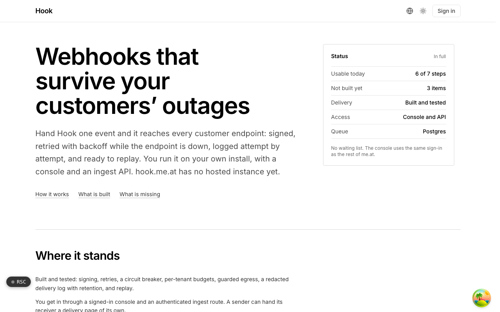

  <picture>
    <source media="(prefers-color-scheme: dark)" srcset=".github/assets/hero-dark.png">
    
  </picture>

# hook.me.at

Webhooks that survive your customers' outages.

Hook is outbound webhook delivery you do not have to operate. Hand it one event and it reaches every customer endpoint: signed, retried with backoff while the endpoint is down, logged attempt by attempt, and ready to replay. It is built for teams that need to send webhooks to their own customers and would rather not build the retry, signing and logging machinery themselves. You run it on your own install, with a console and an ingest API.

## Features

- **Standard Webhooks signing**: every delivery carries the Standard Webhooks signature headers, with a per-endpoint secret and rotation that keeps the old secret valid for a window.
- **Retries that back off**: a published retry schedule with jitter that honours a receiver's `Retry-After` header.
- **A circuit breaker for dead endpoints**: an endpoint that keeps failing is paused instead of retried forever, and its owner gets an email.
- **A searchable delivery log, and replay**: every attempt is logged with a redacted payload copy, kept for a stated retention period, erasable, and re-sendable from the console.
- **A durable queue in the database you already run**: deliveries wait in Postgres and are claimed with row locks, so a self-hosted install needs no Redis.
- **Guarded egress**: outbound requests refuse private addresses and redirects that lead to them, so a customer URL cannot probe your network.
- **Fair sharing**: sharding, in-flight caps and per-tenant budgets keep one noisy tenant from starving the rest.
- **Portal, inboxes and agents**: an expiring delivery page for the receiving side, scripted inspection inboxes to rehearse failures, and an MCP surface scoped to one application.

## Built with

- Next.js 16 (App Router), React 19, TypeScript
- Tailwind CSS 4
- oRPC for the console API
- Drizzle ORM + Postgres (store and job queue)
- Better Auth (the shared me.at account)
- Model Context Protocol (MCP) agent surface
- Optional S3-compatible event stream

## Part of the me.at family

hook.me.at is one of the [`*.me.at`](https://me.at) apps by Trevor McDougald. They share one design system, account, and app shell. Development happens in a private monorepo; this repository is the project's public-facing home.

## License

See [LICENSE](LICENSE).
