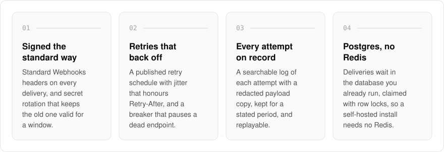
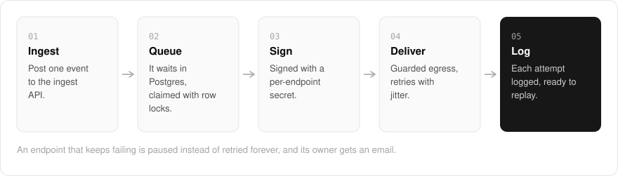

  <picture>
    <source media="(prefers-color-scheme: dark)" srcset=".github/assets/hero-dark.png">
    
  </picture>

<h1 align="center">hook.me.at</h1>

<strong>Webhooks that survive your customers' outages.</strong>

  
  
  
  

  <a href="#features">Features</a> ·
  <a href="#how-it-works">How it works</a> ·
  <a href="#built-with">Built with</a>

Sending webhooks to your customers sounds like one HTTP call, until their endpoint is down, a signature check fails, and someone asks whether the event was ever sent. I built hook.me.at so you hand it one event and it reaches every customer endpoint: signed, retried with backoff while the endpoint is down, logged attempt by attempt, and ready to replay. It is for teams that would rather not build the retry, signing and logging machinery themselves, and it runs on your own install with a console and an ingest API.

  <picture>
    <source media="(prefers-color-scheme: dark)" srcset=".github/assets/overview-dark.svg">
    
  </picture>

## Why hook.me.at

| Building webhooks yourself | hook.me.at |
| --- | --- |
| Invent a signing scheme | Standard Webhooks headers, with secret rotation that keeps the old secret valid for a window |
| Retry forever, or not at all | A published retry schedule with jitter, `Retry-After`, and a circuit breaker |
| "Did it send?" means digging through logs | A searchable log of every attempt, with replay from the console |
| Another Redis to run | A durable queue in the Postgres you already run |
| A customer URL can probe your network | Egress refuses private addresses and redirects that lead to them |

## Features

- **Standard Webhooks signing**: every delivery carries the Standard Webhooks signature headers, with a per-endpoint secret and rotation that keeps the old secret valid for a window.
- **Retries that back off**: a published retry schedule with jitter that honours a receiver's `Retry-After` header.
- **A circuit breaker for dead endpoints**: an endpoint that keeps failing is paused instead of retried forever, and its owner gets an email.
- **A searchable delivery log, and replay**: every attempt is logged with a redacted payload copy, kept for a stated retention period, erasable, and re-sendable from the console.
- **A durable queue in the database you already run**: deliveries wait in Postgres and are claimed with row locks, so a self-hosted install needs no Redis.
- **Guarded egress**: outbound requests refuse private addresses and redirects that lead to them, so a customer URL cannot probe your network.
- **Fair sharing**: sharding, in-flight caps and per-tenant budgets keep one noisy tenant from starving the rest.
- **Portal, inboxes and agents**: an expiring delivery page for the receiving side, scripted inspection inboxes to rehearse failures, and an MCP surface scoped to one application.

## How it works

  <picture>
    <source media="(prefers-color-scheme: dark)" srcset=".github/assets/flow-dark.svg">
    
  </picture>

You post one event to the ingest API, and an outbox decouples that call from delivery, so a slow customer never slows your request. Each delivery waits in Postgres until a worker claims it with a row lock, signs it with the endpoint's secret, and sends it through the guarded outbound client. Every attempt lands in the delivery log, and failures follow the retry ladder until they succeed or the circuit breaker pauses the endpoint.

## Built with

  
  
  
  
  
  

- Next.js 16 (App Router), React 19, TypeScript
- Tailwind CSS 4
- oRPC for the console API
- Drizzle ORM + Postgres (store and job queue)
- Better Auth (the shared me.at account)
- Model Context Protocol (MCP) agent surface
- Optional S3-compatible event stream

## Part of the me.at family

hook.me.at is one of my [`*.me.at`](https://me.at) apps. They share one design system, account, and app shell. Development happens in a private monorepo; this repository is the project's public-facing home.

## License

Source-available. See [LICENSE](LICENSE).
